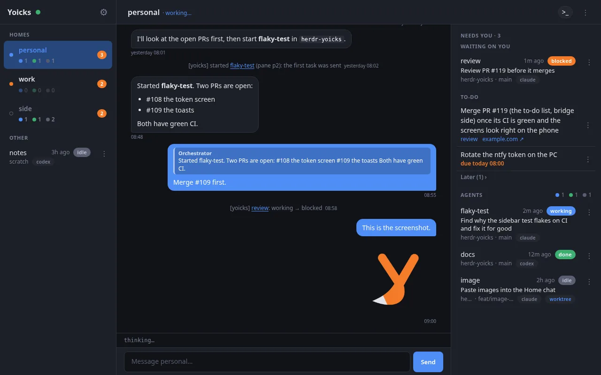

<p align="center">
  <picture>
    <source media="(prefers-color-scheme: dark)" srcset="web/public/icons/lockup.svg">
    
  </picture>
</p>

# herdr-yoicks

[English](./README.md) | **日本語**

*Yoicks* は、狩人が猟犬の群れを先へ駆り立てる掛け声です。

たくさんのコーディングエージェントを、そのうちの 1 つを通して同時に動かすための [herdr](https://herdr.dev) プラグインです。
仕事は **orchestrator** に渡します。**Home** で話しかける Claude Code のエージェントです。orchestrator はタスクごとにワーカーを
起動し (同じリポジトリを並行して変更するものは、それぞれ専用の git worktree で)、進み具合を追い、終わったときやあなたが要る
ときだけ戻ってきます。ヘッドレスの orchestrator は、あなたにしかできないことをやることリストに残し、PR がマージされると
その先へ進みます。小さなローカルのブリッジが、そのすべてをスマホや PC のブラウザに届けます。アカウントもクラウドも要りません。

**ドキュメント: https://yoicks.y011d4.com/docs/ja/** (English: https://yoicks.y011d4.com/docs/en/)

<p align="center">
  
</p>

## インストール

Linux (amd64 か arm64。macOS は試験的な対応) の [herdr](https://herdr.dev) 0.9.5 以降と、スマホからブリッジへ届く経路
(リバースプロキシ、トンネル、VPN のどれか) が必要です。プラグインはビルド済みのバイナリ 1 つで、リリースと一緒にコミットされた
チェックサムで確かめてから入れます。

```bash
herdr plugin install y011d4/herdr-yoicks --ref v0.1.0
herdr plugin action invoke y011d4.yoicks.start                      # ブリッジをデーモンとして起動
herdr plugin pane open --plugin y011d4.yoicks --entrypoint connect  # スマホで開く QR コード
```

## ドキュメント

| ページ | 内容 |
| --- | --- |
| [yoicks とは](https://yoicks.y011d4.com/docs/ja/) | orchestrator がすること、アプリ |
| [インストール](https://yoicks.y011d4.com/docs/ja/guide/install) | 必要要件、更新、前の版に戻す、アンインストール |
| [起動と接続](https://yoicks.y011d4.com/docs/ja/guide/start) | ブリッジのアクションとペイン、接続用の QR |
| [スマホへの公開](https://yoicks.y011d4.com/docs/ja/guide/phone) | リバースプロキシ、トンネル、VPN と HTTPS |
| [アプリの使い方](https://yoicks.y011d4.com/docs/ja/guide/app) | ペイン表示のジェスチャー、キーバインド |
| [orchestrator](https://yoicks.y011d4.com/docs/ja/guide/orchestrators) | ディレクトリ、rules、Claude アカウント |
| [ヘッドレスの orchestrator](https://yoicks.y011d4.com/docs/ja/guide/headless) | ブリッジ自身の `claude -p`、やることリスト、Claude Code の確認 |
| [設定 (config)](https://yoicks.y011d4.com/docs/ja/reference/config) | `config.json` のすべてのキー |
| [yoicks が決めること、あなたが決めること](https://yoicks.y011d4.com/docs/ja/reference/built-in-vs-configured) | 組み込みのものと、自分で設定するもの |
| [yoicks のコマンド](https://yoicks.y011d4.com/docs/ja/reference/cli) | orchestrator がワーカーを動かす CLI |
| [API](https://yoicks.y011d4.com/docs/ja/reference/api) | スクリプト用の REST と WebSocket |
| [セキュリティモデル](https://yoicks.y011d4.com/docs/ja/reference/security) | トークン、待ち受けるアドレス、外へ出るもの |
| [対応状況と困ったとき](https://yoicks.y011d4.com/docs/ja/reference/troubleshooting) | 対応環境、既知の制限、確かめること |
| [開発とリリース](https://yoicks.y011d4.com/docs/ja/development) | ソースからのビルド、テスト、リリース |

ドキュメントのソースは [`site/docs/`](site/docs/) にあります (英語と日本語で同じページ)。[`CLAUDE.md`](CLAUDE.md) は、この
リポジトリで作業するエージェント向けです。

## ライセンス

[MIT](LICENSE)
